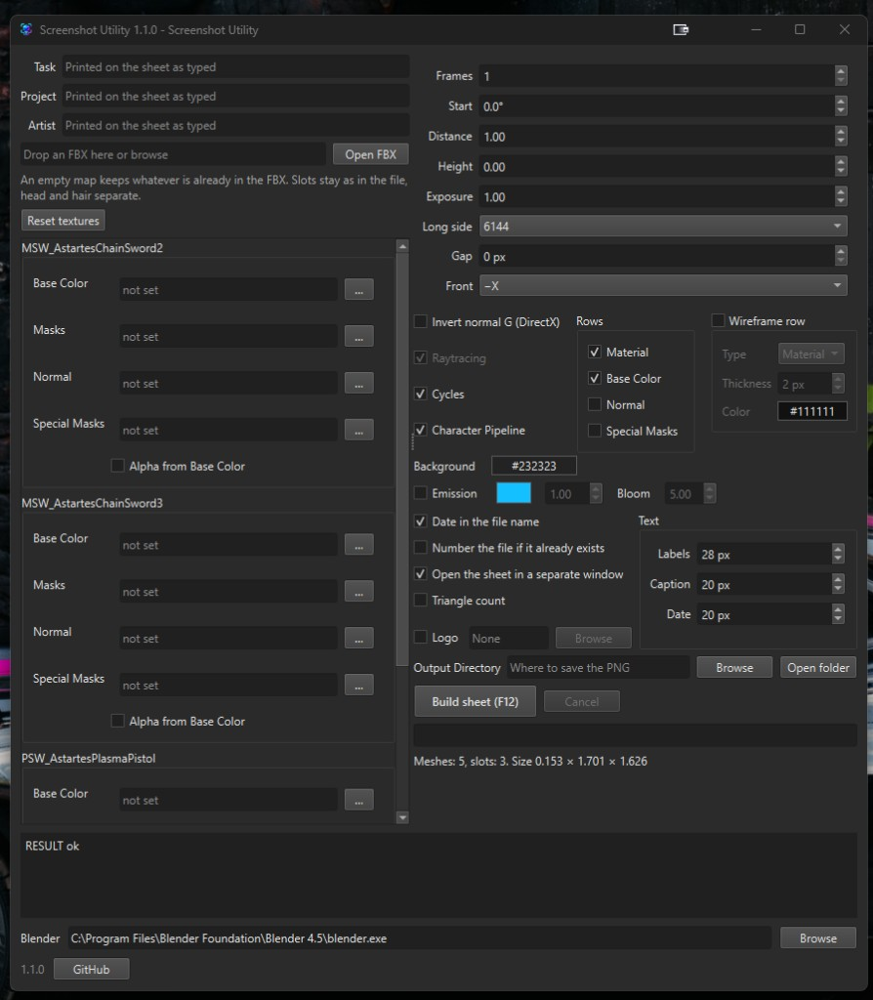

# FBX Screenshot Utility

Desktop app for Windows. Drop an FBX in, assign textures to the existing material slots, and build a turnaround sheet. Blender renders in the background. There is no live viewport.

## Requirements

- Windows.
- [Blender 4.5 or newer](https://www.blender.org/download/). 4.5 is the oldest version that works. Newer releases are fine. The sheet is rendered by Blender in the background.
- Python is only needed to run from source or to build the folder. The packaged build does not include it.
- [Python 3.13](https://www.python.org/downloads/windows/). Use the official Windows installer and keep the **py launcher** enabled. `py -3.13` comes from that installer.
- Libraries, unchanged: PySide6 and Pillow, from `requirements.txt`.



## What it does

- Reads an FBX and keeps the material slot names. Head and hair stay separate.
- An empty texture field keeps whatever is already stored in the FBX.
- Builds one PNG sheet. Each row is a pass, each column is a camera angle.
- The **Long side** value is the long side of the finished sheet, not of a single frame.
- Camera: frame count, start angle, distance scale, and height as a fraction of the model. The cameras are spaced evenly around a full turn. Two frames are front and side, 90° apart. `0°` looks from the chosen front (`−Y`, `+Y`, `−X`, `+X`). Up is Z.
- Optional rows: Base Color (unlit), Normal, and a lit Material. Wireframe can be added as its own row, in a chosen color, over a chosen pass.
- The lit Material row gets a soft disc under the feet, so the character reads as standing on something. It is not a shadow from the key light, and the flat texture rows do not get it.
- Under each texture row name the sheet prints that map's resolution, for example `4096×4096`. Material and wireframe rows skip it. If several slots disagree, the sizes are listed side by side.
- Background color is shared by the render and the sheet padding.
- **Build sheet (F12)** writes the PNG. The path row just above the button is **Output Directory**. The sheet can open in its own window, scaled to fit that window. Last folders, texture assignments, and options are remembered.
- The title bar shows the version. **GitHub**, next to the version at the bottom left, opens the repository.

## On the sheet

Text uses **Exon Regular**, bundled in `fonts/`. There is no font picker. **Labels**, **Caption**, and **Date** are sizes for a 512 px frame and scale with the sheet.

The dark bar at the bottom holds Task, Project, and Artist, left-aligned, in that order. Empty lines are left out. The labels are a bit dimmer than the values. One **Caption** size covers all three.

The date sits in the top right at half opacity. The same inset is used on the right of the logo.

**Logo** is off by default. Turn it on, pick a file, and it lands in the bottom right of the dark bar. Height comes from the bar, not from the file, and transparent edges are trimmed first.

**Triangle count** is off by default. When it is on, `Triangles Count:` plus the number (grouped with spaces) sits just above the dark bar, at the bottom of the frames. The count is tessellated triangles, so a quad counts as two.

The date can also go into the file name. If that file already exists, a number is appended.

## Character Pipeline

On by default. This is the packed character layout, not a set of separate roughness and metallic files.

| Slot | What it is |
| --- | --- |
| Base Color | Albedo. Opacity can live in the alpha channel. |
| Masks | Packed mask. See the channels below. |
| Normal | Normal map. |
| Special Masks | Optional extra mask. Off unless you turn that row on. |

**Masks**

| Channel | Map |
| --- | --- |
| R | Roughness. Bright is rough. |
| G | Emissive, off unless Emission is checked. The mask is only the brightness. Color, strength, and bloom are set next to that checkbox, and bloom stays off while emission is off. |
| B | Metallic. |
| A | Translucency. |

**Alpha from Base Color** is off by default. Turn it on only when the base color really carries opacity. Hair cards often need it. A solid head usually does not.

**Special Masks** is an optional texture and an optional sheet row. Leave both alone unless you want that mask on the sheet.

**Split Masks Texture**, under the texture list, writes the Masks map out as separate grayscale files next to the source: `[name]_Roughness`, `_Emissive`, `_Metallic`, and `_Translucency` when the file has an alpha channel. Same folder and extension. Running it again overwrites those files. Roughness is copied as stored: bright stays rough.

Turn Character Pipeline off to assign Roughness or Smoothness, Metallic, AO, and Opacity as separate files. Smoothness means bright is glossy (`1 − roughness`).

## Run

From this folder:

```bat
py -3.13 -m venv .venv
.venv\Scripts\python -m pip install -r requirements.txt
```

That installs the window toolkit and the image library. Launch `Screenshot Utility.bat` after that. If `blender.exe` is not in `C:\Program Files\Blender Foundation\Blender 4.5\`, set the path at the bottom of the window.

`scripts\build_folder.bat` packs the utility into `dist\Screenshot Utility\`. Run `Screenshot Utility.exe` in that folder. Blender is not included.

## Blender addon

`addons/screenshot_utility.zip` is an addon for Blender 4.5 or newer. In Blender: Edit → Preferences → Add-ons → Install from Disk, pick that zip, then enable **Screenshot Utility**.

The button is **Build Screen List**. It sits in the top right corner of the Blender window and has a monitor icon.

It exports the meshes and starts a sheet in this utility, using the settings already set here (angles, passes, background, captions).

- A selection sends those meshes and their child meshes. With nothing selected, it sends every visible mesh.
- Textures already on the materials stay in the FBX. Empty texture fields in the utility still keep whatever the file already has.
- If this window is closed, the button opens it and then renders. Open the utility once so the addon knows where it lives. If it still cannot find it, set **Utility folder** in the addon preferences to this project folder.
