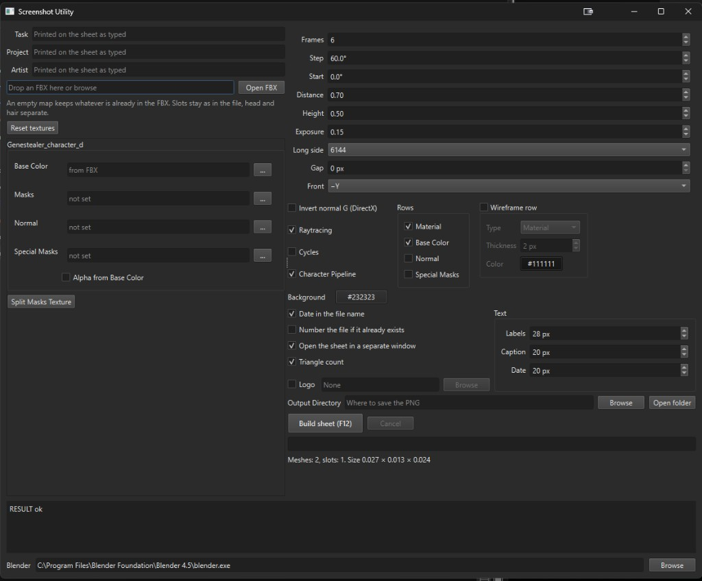

# FBX Screenshot Utility

Desktop app for Windows. Build a turnaround sheet from an FBX or from views captured in ZBrush. FBX renders use Blender in the background. There is no live viewport.

## Requirements

- Windows.
- [Blender 4.5 or newer](https://www.blender.org/download/) is required for FBX rendering. ZBrush image sheets do not need Blender.
- Python is only needed to run from source or to build the folder. The packaged build does not include it.
- [Python 3.13](https://www.python.org/downloads/windows/). Use the official Windows installer and keep the **py launcher** enabled. `py -3.13` comes from that installer.
- Libraries, unchanged: PySide6 and Pillow, from `requirements.txt`.



## What it does

- Reads an FBX and keeps the material slot names. Head and hair stay separate.
- An empty texture field keeps whatever is already stored in the FBX.
- Builds one PNG sheet. Each row is a pass, each column is a camera angle.
- The **Long side** value is the long side of the finished sheet, not of a single frame.
- Camera: frame count, start angle, distance scale, and height as a fraction of the model. The cameras are spaced evenly around a full turn. Two frames are front and side, 90° apart. `0°` looks from the chosen front (`−Y`, `+Y`, `−X`, `+X`). Up is Z.
- Optional rows: Base Color (unlit), Normal, and a lit Material. Wireframe can be added as its own row, in a chosen color, over a chosen pass. Turn off **Use Textures** in Wireframe row to render a solid mesh with a chosen Base Color and Roughness (0–1). Enable **Unlit** to render the surface without lighting; Roughness has no effect in this mode.
- The lit Material row gets a soft disc under the feet, so the character reads as standing on something. It is not a shadow from the key light, and the flat texture rows do not get it.
- Under each texture row name the sheet prints that map's resolution, for example `4096×4096`. Material and wireframe rows skip it. If several slots disagree, the sizes are listed side by side.
- Background color is shared by the render and the sheet padding.
- **Build sheet (F12)** writes the PNG. The path row just above the button is **Output Directory**. The sheet can open in its own window, scaled to fit that window. Last folders, texture assignments, and options are remembered.
- The title bar shows the version. **GitHub**, next to the version at the bottom left, opens the repository.
- On startup, the app checks for a newer stable release and displays a link next to **GitHub** when one is available.

## Wireframe row

Enable **Wireframe row** to add a separate row with mesh edges. **Type** selects the pass under the wireframe; **Thickness** and **Color** control the edges. **Use Textures** is on by default and uses the assigned or imported textures for the selected pass.

Turn **Use Textures** off to render an opaque mesh with a uniform **Base Color** and a numeric **Roughness** from 0 (smooth) to 1 (rough). This uses the lit material setup and does not change the other sheet rows. **Type** is unavailable in this mode.

Enable **Unlit** to render the surface without lighting. With textures on, the Material pass uses Base Color; other passes retain their existing unlit appearance. With textures off, the chosen Base Color is used directly. Roughness has no effect in Unlit mode and its control is disabled. All wireframe settings are remembered between launches.

## On the sheet

Text uses **Exon Regular**, bundled in `fonts/`. There is no font picker. **Labels**, **Caption**, and **Date** are sizes for a 512 px frame and scale with the sheet.

The dark bar at the bottom holds Task, Project, and Artist, left-aligned, in that order. Empty lines are left out. The labels are a bit dimmer than the values. One **Caption** size covers all three.

The date sits in the top right at half opacity. The same inset is used on the right of the logo.

**Logo** is off by default. Turn it on, pick a file, and it lands in the bottom right of the dark bar. Height comes from the bar, not from the file, and transparent edges are trimmed first.

**Triangle count** is off by default. When it is on, `Triangles Count:` plus the number (grouped with spaces) sits just above the dark bar, at the bottom of the frames. The count is tessellated triangles, so a quad counts as two.

Choosing an FBX suggests `[FBX name]_[dd.mm.yyyy].png` in the output field. You can edit the name; choosing another FBX replaces it with that model's name. The date can be turned off. If the file already exists, a number can be appended.

## Character Pipeline

On by default. This is the packed character layout, not a set of separate roughness and metallic files.

| Slot | What it is |
| --- | --- |
| Base Color | Albedo. Opacity can live in the alpha channel. |
| Masks | Packed mask. See the channels below. |
| Normal | Normal map. |
| Special Masks | Optional extra mask. Off unless you turn that row on. |

**Masks**

| Channel | Map |
| --- | --- |
| R | Roughness. Bright is rough. |
| G | Emissive, off unless Emission is checked. The mask is only the brightness. Color, strength, and bloom are set next to that checkbox, and bloom stays off while emission is off. |
| B | Metallic. |
| A | Translucency. |

**Alpha from Base Color** is off by default. Turn it on only when the base color really carries opacity. Hair cards often need it. A solid head usually does not.

**Special Masks** is an optional texture and an optional sheet row. Leave both alone unless you want that mask on the sheet.

**Split Masks Texture**, under the texture list, writes the Masks map out as separate grayscale files next to the source: `[name]_Roughness`, `_Emissive`, `_Metallic`, and `_Translucency` when the file has an alpha channel. Same folder and extension. Running it again overwrites those files. Roughness is copied as stored: bright stays rough.

**Extract Opacity** sits next to that button and is off by default. Turn it on and the same click also writes the Base Color alpha beside that file as `[name]_Opacity`. A Base Color with no alpha is skipped.

Turn Character Pipeline off to assign Roughness or Smoothness, Metallic, AO, and Opacity as separate files. Smoothness means bright is glossy (`1 − roughness`).

## Run

From this folder:

```bat
py -3.13 -m venv .venv
.venv\Scripts\python -m pip install -r requirements.txt
```

That installs the window toolkit and the image library. Launch `Screenshot Utility.bat` after that. If `blender.exe` is not in `C:\Program Files\Blender Foundation\Blender 4.5\`, set the path at the bottom of the window.

`scripts\build_folder.bat` packs the utility into `dist\Screenshot Utility\`. Run `Screenshot Utility.exe` in that folder. Blender is not included.

## Blender addon

`addons/screenshot_utility.zip` is an addon for Blender 4.5 or newer. In Blender: Edit → Preferences → Add-ons → Install from Disk, pick that zip, then enable **Screenshot Utility**.

The button is **Build Screen List**. It sits in the top right corner of the Blender window and has a monitor icon.

It exports the meshes and starts a sheet in this utility, using the settings already set here (angles, passes, background, captions).

- A selection sends those meshes and their child meshes. With nothing selected, it sends every visible mesh.
- Textures already on the materials stay in the FBX. Empty texture fields in the utility still keep whatever the file already has.
- If this window is closed, the button opens it and then renders. Open the utility once so the addon knows where it lives. If it still cannot find it, set **Utility folder** in the addon preferences to this project folder.

## ZBrush script

The release includes `ScreenshotUtilityPrototype.txt` as a separate download. The script has been tried with ZBrush 2026.2.1. Compatibility with earlier versions has not yet been verified.

To load the script, save the `.txt` file in a folder you can find again. In ZBrush, open **ZScript → Load** and choose that file. Open **ZPlugin → Screenshot Utility** to find the controls. For automatic loading, copy the `.zsc` file generated alongside the `.txt` into ZBrush's `ZStartup/ZPlugs64` folder and restart ZBrush. From ZBrush 2026.1 onwards this is the `ZStartup/ZPlugs64` folder under the user asset directory, available through **Preferences → Asset Directory → Open Directory**. Earlier versions use `ZStartup/ZPlugs64` inside the ZBrush installation. When updating, load the new `.txt` to generate a new `.zsc`, replace the installed `.zsc`, and restart ZBrush.

1. Open the model in Edit mode, choose the visible SubTools and MatCap, and position the starting view. A straight front view is recommended.
2. Click **Choose output folder**, navigate to a folder, and press Save. The folder is remembered between ZBrush sessions. Set **Views** and click **Capture views**. The script captures the current document with its background and material and restores the starting view. Files are named `ScreenshotUtility_viewsN_0.png`, `ScreenshotUtility_viewsN_1.png`, and so on, where N is the number of views. Capturing again replaces that series; changing the number of views removes the preceding series created by the script in that folder.
3. In Screenshot Utility, set the caption, logo, gap and final sheet size as needed. Click **Build from ZBrush views** and select the image ending in `_0.png`. Choose where to save the sheet. The utility remembers the image folder for next time.

Two views are 90° apart. Other counts are evenly spaced around a full turn. The output uses the current ZBrush preview and does not export geometry or start Blender. The utility crops the center of each view, so keep the model centered with room at the sides. For nonuniform backgrounds, the sheet background uses a color sampled from the first view.

The resolution of the captured images depends on the **ZBrush document (canvas) size**, not the number of polygons. Set the document size in ZBrush before capturing. The **Long side** setting in Screenshot Utility controls the final sheet size and cannot recover detail missing from smaller source images. ZBrush's AAHalf view exports at half the document dimensions.
